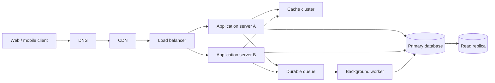

# QuickNotes service architecture

## Requirements

### Functional

- Register and authenticate users securely.
- Create, list, read, update and delete notes belonging only to the authenticated user.
- Create and manage tags, associate many tags with each note, and filter/search notes.
- Return paginated results and clear validation and authorization errors.
- Keep user data durable and make note changes visible consistently after writes.

### Non-functional

- Support 1 million registered users with horizontal application scaling.
- Meet a target of 99.9% monthly API availability and p95 response latency below 300 ms for ordinary reads.
- Encrypt traffic in transit and storage at rest; enforce tenant isolation and least privilege.
- Back up the primary database, monitor service health, and recover from an instance or zone failure.
- Scale read-heavy traffic independently and process slow side effects asynchronously.

## Capacity estimate for 1 million users

Planning assumptions: 10% daily active users (100,000 people), each active user reads 20 notes and creates 2 notes per day, a 5x peak-to-average traffic factor, and an average stored note size of 2 KB including metadata and index overhead. Attachments and replicas are excluded.

| Measure | Estimate |
|---|---:|
| Reads | 2,000,000/day = about 23 average requests/second; plan for about 116 peak reads/second. |
| Writes | 200,000/day = about 2.3 average requests/second; plan for about 12 peak writes/second. |
| New note storage | 200,000 × 365 × 2 KB = about 146 GB/year of logical note data. |
| User storage | About 1 GB for 1 million user records at a planning estimate of 1 KB each. |

These are first-pass sizing numbers, not guarantees. Instrument real payload sizes and active-user behavior, then load-test and revise capacity, indexes, and retention before launch.

## Architecture

| Component | Problem it solves |
|---|---|
| Client | Presents the product UI and sends authenticated API requests over HTTPS. |
| DNS | Resolves the service hostname to its globally routable edge entry point. |
| CDN | Caches static application assets near users and absorbs repeat asset traffic. |
| Load balancer | Health-checks application instances and spreads API requests across them. |
| Application servers A and B | Run stateless API logic and can scale horizontally or replace a failed instance. |
| Cache cluster | Reduces repeated hot-note and session reads, with TTLs and invalidation after writes. |
| Primary database | Provides durable transactional writes and the authoritative relational record. |
| Read replica | Serves eligible read traffic and reduces query load on the primary. |
| Durable queue | Buffers retryable side effects so slow work does not delay API responses. |
| Background worker | Consumes queued tasks such as notifications and audit exports with retry and idempotency. |

## Request flows

### `GET /v1/notes`

1. The client resolves the API hostname through DNS, connects over HTTPS, and sends its bearer token and pagination/filter parameters.
2. The CDN passes dynamic API traffic to the load balancer; the load balancer routes the request to a healthy application server.
3. The application validates the token, derives the user ID from trusted claims, and validates query parameters.
4. The application checks the cache using a key scoped to that user and query; on a miss, it queries the read replica using the user ID and pagination cursor.
5. The application shapes the page and cursor, returns JSON, and caches safe results for a short TTL; the response travels back through the load balancer to the client.

### `POST /v1/notes`

1. The client sends the note JSON with its bearer token over HTTPS through DNS, CDN pass-through and the load balancer to a healthy application server.
2. The application authenticates the user, validates the title and body, and verifies any tag IDs are owned by that user.
3. In one primary-database transaction, the application inserts the note and any requested `note_tags` associations.
4. After commit, it invalidates or versions affected cache keys and publishes any asynchronous side-effect job to the durable queue (or writes a transactional outbox record for reliable publication).
5. The application returns `201 Created` with the persisted note; a worker later handles queued work and uses retries/idempotency to avoid duplicate effects.

## Trade-offs and failure resilience

- **Read replica versus read-after-write consistency:** replicas scale reads, but replication lag can hide a just-created note. Send a user's immediate follow-up reads to the primary (or return the created record directly) and use the replica for ordinary list reads.
- **Cache speed versus freshness:** cached note lists can become stale. Use short TTLs, user-scoped keys, and explicit invalidation/versioning after writes; the database remains authoritative.
- **Queue decoupling versus eventual side effects:** queued notifications and exports may be delayed or retried. Make workers idempotent, expose queue age and failure metrics, and use a transactional outbox so a committed note is not separated from its event.

There is no single application-server failure point because multiple stateless instances sit behind health checks and can be replaced. The database is deployed as a managed multi-zone primary with automated failover and backups; the read replica provides read capacity and a promotion candidate. DNS, CDN and load balancing use managed redundant services, while the durable queue replicates messages across zones. These controls reduce single points of failure but do not eliminate the need for tested failover and restore procedures.
